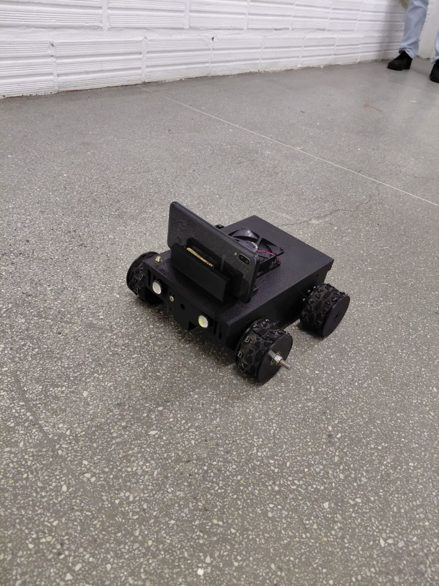
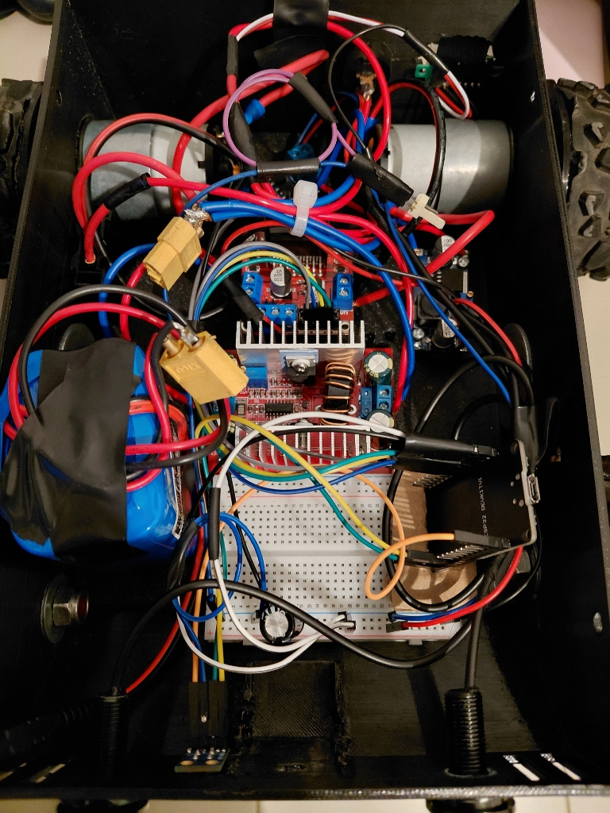
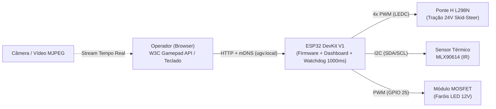

# Robô Inspetor Terrestre (UGV)

> **Plataforma robótica terrestre (UGV) de baixo custo para inspeção remota visual e termográfica preditiva — com chassi dielétrico em PETG (*CAD-as-Code*), firmware modular em ESP32 (PlatformIO), sensor infravermelho MLX90614 (I2C), Watchdog Failsafe e teleoperação via navegador (mDNS + W3C Gamepad API).**

-3776AB?style=for-the-badge&logo=python&logoColor=white)
-323330?style=for-the-badge&logo=javascript&logoColor=F7DF1E)

---

## Protótipo Físico & Eletrônica Embarcada

| Protótipo Montado (Chassi PETG 3D + Faróis + Cooler) | Eletrônica Interna (ESP32 + L298N + Step-Up/Down + Li-Ion 3S2P) |
| :---: | :---: |
|  |  |

---

## 1. Arquitetura Geral & Fluxo de Teleoperação

### Decisões Técnicas & Trade-offs
| Desafio de Engenharia | Decisão Adotada | Por que esta escolha (Trade-off)? |
| :--- | :--- | :--- |
| **Quedas de tensão (*Brownout*)** na ESP32 durante partida dos motores | **Barramentos isolados:** Step-Up `24V` para potência + Step-Down `LM2596 5V` dedicado à lógica + capacitor eletrolítico | Evita reinicializações da ESP32 nos picos de corrente dos motoredutores DC `GB37-520`, mantendo terra comum (`GND`). |
| **Segurança operacional** em perda de Wi-Fi ou superaquecimento | **Watchdog Failsafe (`1000 ms`)** + corte por sobretemperatura no `MLX90614` | Desliga automaticamente os 4 canais PWM se o operador perder conexão ou detectar anomalia térmica crítica. |
| **Isolamento dielétrico e custo** (NR-10 / NR-12 / NR-33) | **Chassi monobloco em PETG** modelado via **CAD-as-Code (`build123d`)** | Reduz o custo de plataformas industriais (R$ 27k–750k) para **~R$ 754**, versionando a mecânica no Git e eliminando atrito metal-metal. |
| **Descoberta em rede local** sem IP fixo e controle intuitivo | **mDNS (`ugv.local`)** + **W3C Gamepad API** (PS5/Xbox/USB) | Elimina configuração manual de IPs em campo e permite pilotagem analógica precisa direto no navegador. |

---

## 2. Distribuição de Energia e Módulos de Potência

Toda a alimentação parte da bateria **3S2P Li-Ion (~11.1V a 12.6V)** conectada via plugue **XT60**:

| Subsistema / Módulo | Ligação Positiva (`+`) | Ligação Negativa (`GND`) | Saídas e Detalhes da Montagem |
| :--- | :--- | :--- | :--- |
| **Chicote Principal 12V** | `XT60 (+)` → Chave Gangorra **KCD1** → **Fusível 15A** | `XT60 (-)` dividido para `IN-` do Step-Up, `IN-` do Step-Down e `VIN-` do MOSFET | Alimenta em 12V o Step-Up, Step-Down, MOSFET, Voltímetro e Cooler 80mm. |
| **Cooler / Fan 80mm (12V)** | Fio **Vermelho** direto no Chicote 12V pós-chave | Fio **Preto** no Trilho Azul (`-` GND) da protoboard | Fio amarelo (tacômetro) isolado. Gira continuamente ao ligar a chave. |
| **Voltímetro Digital (3 Fios)** | Fios **Vermelho + Branco unidos** no Chicote 12V pós-chave | Fio **Preto** no Trilho Azul (`-` GND) da protoboard | Mede a tensão da bateria direto no painel físico do chassi. |
| **Módulo MOSFET (`XY-MOS V921`)** | Borne **`VIN+`** no Chicote 12V pós-chave | Borne **`VIN-`** no Chicote Negativo da bateria | • **`OUT+` / `OUT-`:** Faróis Olho de Águia. • Lógica: `TRIG/PWM` no **`GPIO 25`** e `GND` no Trilho `-`. |
| **Step-Up 400W (12V → 24V)** | Borne **`IN+`** no Chicote 12V | **`IN-`** no Negativo da bateria; **`OUT-`** no `GND` da L298N | Borne **`OUT+` (24V)** vai direto ao borne `12V/VCC` da Ponte H L298N. |
| **Step-Down LM2596 (12V → 5V)** | Borne **`IN+`** no Chicote 12V | **`IN-`** no Negativo da bateria; **`OUT-`** no **Trilho Azul (`-`)** | Borne **`OUT+` (5V)** alimenta o **Trilho Vermelho (`+`)** e o borne `5V` da L298N. |
| **Ponte H L298N** | Motores: **24V** (Step-Up) / Lógica: **5V** (Step-Down) | **`GND`** recebe `OUT-` do Step-Up + fio para o Trilho Azul (`-`) | **Jumper regulador 5V removido**. Jumpers `ENA`/`ENB` fechados. `OUT1/2` (Motor Esq.) e `OUT3/4` (Motor Dir.). |

---

## 3. Pinagem Oficial — ESP32 DevKit V1 (Master)

| Pino ESP32 | Constante (`config.h`) | Cor do Jumper | Destino | Função |
| :--- | :--- | :--- | :--- | :--- |
| **`GPIO 26`** | `PIN_MOTOR_LEFT_IN1` | Cinza | `IN 1` (L298N) | PWM Motor Esquerdo Sentido A (LEDC 0) |
| **`GPIO 27`** | `PIN_MOTOR_LEFT_IN2` | Azul | `IN 2` (L298N) | PWM Motor Esquerdo Sentido B (LEDC 1) |
| **`GPIO 14`** | `PIN_MOTOR_RIGHT_IN3` | Amarelo | `IN 3` (L298N) | PWM Motor Direito Sentido A (LEDC 2) |
| **`GPIO 13`** | `PIN_MOTOR_RIGHT_IN4` | Verde | `IN 4` (L298N) | PWM Motor Direito Sentido B (LEDC 3) |
| **`GPIO 25`** | `PIN_HEADLIGHT_MOSFET` | Cinza | `TRIG/PWM` (MOSFET) | Controle PWM/Digital dos Faróis (LEDC 4) |
| **`GPIO 21` (`SDA`)** | `PIN_I2C_SDA` | Amarelo | `SDA` (MLX90614) | Dados I2C + Pull-up `4.7kΩ` em `3V3` |
| **`GPIO 22` (`SCL`)** | `PIN_I2C_SCL` | Verde | `SCL` (MLX90614) | Clock I2C + Pull-up `4.7kΩ` em `3V3` |
| **`3V3`** | — | Laranja | `VIN` (MLX90614) | Alimentação 3.3V do sensor e pull-ups |
| **`VIN` (`5V`)** | — | Branco/Vermelho | Trilho `+` 5V | Alimentação da placa (remover ao gravar via USB) |
| **`GND`** | — | Preto/Branco | Trilho `-` GND | Referência comum de terra (0V) |

---

## 4. Gravação e Teste Rápido (VS Code + PlatformIO)

1. **Gravar ESP32 DevKit V1 (Master):**
   - Remova temporariamente o jumper `VIN/5V` da protoboard antes de plugar o cabo USB.
   - Selecione `env:esp32_hardware` no PlatformIO e clique em **Upload** (`→`).
2. **Testar Motores, Sensores e Dashboard:**
   - Conecte no Wi-Fi `ROBO_INSPETOR_UGV` (senha `12345678`) e acesse `http://192.168.4.1` (ou `http://ugv.local`), ou pressione `t` no Monitor Serial para rodar o auto-teste sequencial.
