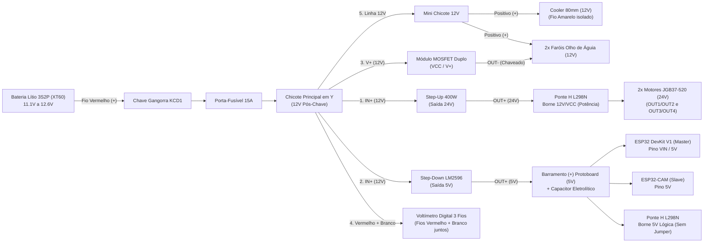
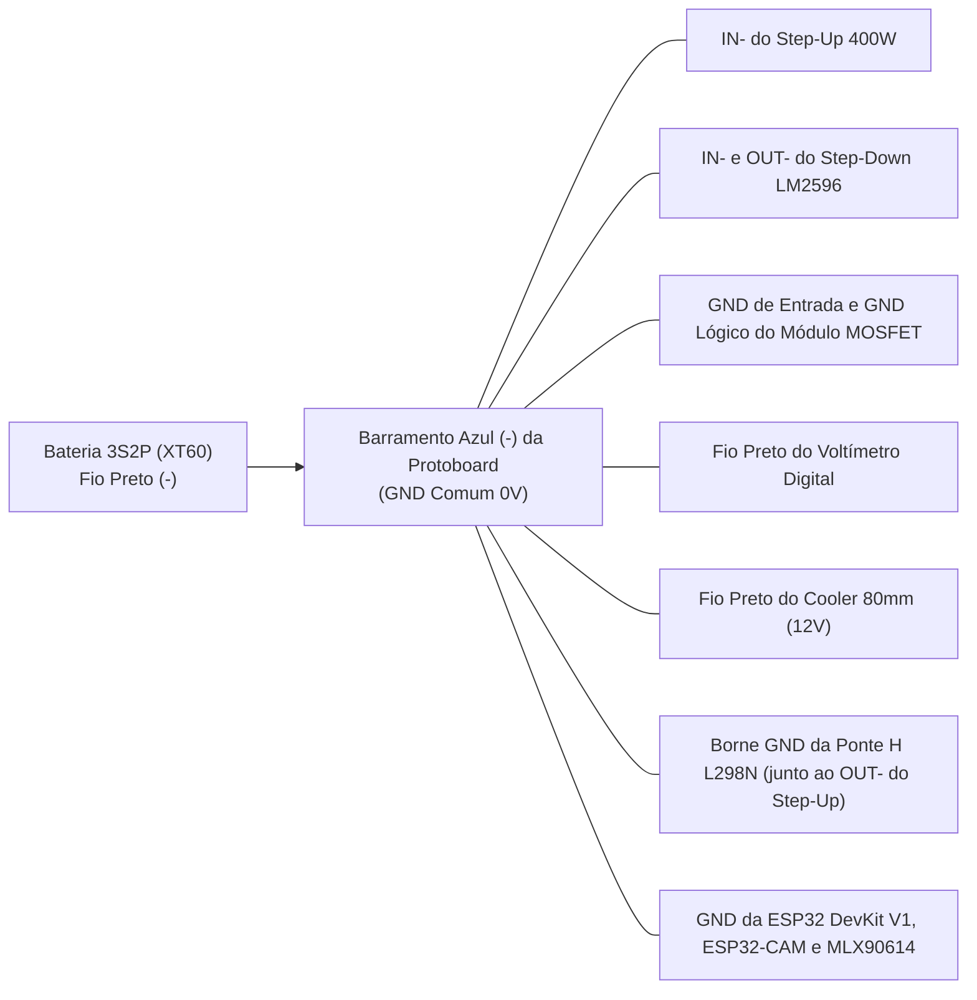

# 01. Visão Geral e Distribuição de Energia (12V, 24V e 5V)

Arquitetura elétrica e divisão de processamento do **Robô Inspetor Terrestre (UGV)**:
- **ESP32 DevKit V1 (Master — IP `192.168.4.1`):** Cria o Wi-Fi próprio do robô (`ROBO_INSPETOR_UGV`, senha `12345678`) e controla o Painel Web, Ponte H L298N (motores), Módulo MOSFET (faróis) e Sensor Térmico MLX90614.
- **ESP32-CAM (Slave — IP `192.168.4.2`):** Conecta no Wi-Fi da Master e fica 100% dedicada ao streaming de vídeo MJPEG na porta `81` (`http://192.168.4.2:81/stream`).

---

## 1. Diagrama de Energia e Potência (12V, 24V, 5V e GND)

### Diagrama do Barramento de Terra (GND Comum — 0V)

---

## 2. Passo a Passo da Distribuição Elétrica

### Passo 1 — Linha de Entrada e Proteção (12V Pós-Chave)
1. Ligue o fio **Positivo (Vermelho)** do conector **XT60** na **Chave Gangorra KCD1** e, na saída dela, instale o **Porta-Fusível de 15A**.
2. Abra a saída do fusível no **Chicote Principal em Y (12V)** e conecte nas 5 pontas:
   - **Ponta 1:** Borne **`IN+`** do Conversor **Step-Up 400W**.
   - **Ponta 2:** Borne **`IN+`** do Conversor **Step-Down LM2596**.
   - **Ponta 3:** Borne **`VCC` (`V+`)** de entrada do **Módulo MOSFET Duplo**.
   - **Ponta 4:** **Fios Vermelho + Branco** (soldados juntos) do **Voltímetro Digital de 3 Fios**.
   - **Ponta 5 (Mini Chicote 12V):** Fio positivo (vermelho) do **Cooler de 80mm (12V)** + fios positivos (vermelhos) dos dois **Faróis Olho de Águia (12V)**.

### Passo 2 — Barramento de Terra (GND Comum — 0V)
1. Ligue o fio **Negativo (Preto)** do conector **XT60** no barramento azul/negativo (`-`) da protoboard.
2. Interligue nesse mesmo barramento o terra de todos os módulos:
   - **`IN-`** do Step-Up 400W e **`IN-`** do Step-Down LM2596.
   - **`GND` de entrada** e **`GND` lógico** do Módulo MOSFET.
   - **Fio Preto** do Voltímetro Digital.
   - **Fio Preto** do Cooler de 80mm *(isole o terceiro fio amarelo de tacômetro)*.
   - **`GND`** da Ponte H L298N.
   - **`GND`** da ESP32 DevKit V1, da ESP32-CAM e do sensor MLX90614.

### Passo 3 — Linha de 24V (Motores — Saída do Step-Up 400W)
1. Ajuste o trimpot do Step-Up 400W para **24,0 V** antes de ligar na Ponte H.
2. Conecte **`OUT+ (24V)`** no borne **`12V/VCC`** da **Ponte H L298N**.
3. Conecte **`OUT-`** no borne **`GND`** da **Ponte H L298N**.
4. Ligue os **Motores JGB37-520 (24V)** nos bornes laterais **`OUT1`/`OUT2`** (Esquerdo) e **`OUT3`/`OUT4`** (Direito) da L298N.

### Passo 4 — Linha de 5V (Lógica — Saída do Step-Down LM2596)
1. Ajuste o trimpot do Step-Down LM2596 para **5,00 V** antes de alimentar as placas.
2. Conecte **`OUT+ (5V)`** no barramento positivo (`+`) da protoboard (com capacitor eletrolítico de filtro no trilho).
3. Distribua os 5V da protoboard para:
   - Pino **`VIN` / `5V`** da **ESP32 DevKit V1**.
   - Pino **`5V`** da **ESP32-CAM**.
   - Borne **`5V` (Lógica)** da **Ponte H L298N** *(remova obrigatoriamente o jumper regulador de 5V da placa L298N)*.
