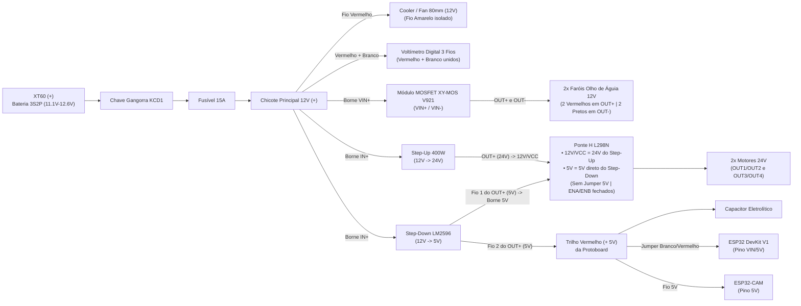
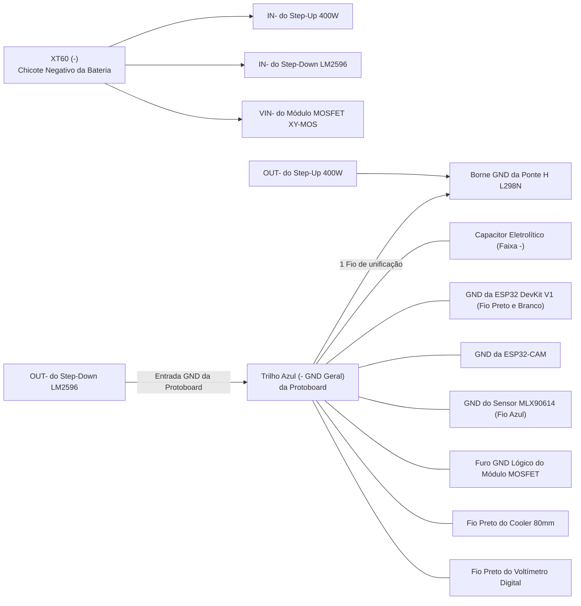

# 01. Visão Geral e Distribuição Oficial de Energia (12V, 24V e 5V)

Consolidação oficial da arquitetura Master/Slave e distribuição de potência do **Robô Inspetor Terrestre (UGV)**.

---

## 1. Arquitetura Geral do Hardware (Master / Slave)

* **ESP32 DevKit V1 (Master — IP `192.168.4.1` / `192.168.1.100`):** Centraliza o controle da Ponte H L298N via 4 canais PWM (`GPIO 26, 27, 14, 13`), a leitura I2C do sensor térmico MLX90614 (`GPIO 21, 22`), o acionamento dos faróis via Módulo MOSFET (`GPIO 25`), o Dashboard Web e o *Watchdog Failsafe* de `1000 ms`.
* **ESP32-CAM (Slave — IP `192.168.4.2` / `192.168.1.101`, Porta `81`):** Dedicada exclusivamente ao streaming de vídeo MJPEG (`/stream`). Alimentada apenas pelos pinos `5V` e `GND`, mantendo os pinos `GPIO 12, 13, 14, 15, U0T e U0R` totalmente desconectados para evitar falha de inicialização (*boot*).

---

## 2. Diagrama de Distribuição de Energia (12V, 24V, 5V e GND)

### Diagrama do Chicote Negativo e Trilho Azul (`-` GND Geral)

---

## 3. Tabela Completa de Distribuição de Energia e Módulos de Potência

| Subsistema / Módulo | Ligação Positiva (`+`) | Ligação Negativa (`GND`) | Saídas e Detalhes da Montagem |
| --- | --- | --- | --- |
| **Chicote Principal 12V** | Sai do `XT60 (+)` -> Chave Gangorra **KCD1** -> **Fusível 15A** | Sai do `XT60 (-)` e divide-se para o `IN-` do Step-Up, `IN-` do Step-Down e `VIN-` do MOSFET | Alimenta em 12V o Step-Up, Step-Down, MOSFET, Voltímetro e Cooler 80mm. |
| **Cooler / Fan 80mm (12V)** | Fio **Vermelho** direto no Chicote 12V pós-chave | Fio **Preto** no Trilho Azul (`-` GND) da protoboard | Fio amarelo (tacômetro) isolado/sem uso. Gira continuamente ao ligar a chave. |
| **Voltímetro Digital (3 Fios)** | Fios **Vermelho + Branco unidos** no Chicote 12V pós-chave | Fio **Preto** no Trilho Azul (`-` GND) da protoboard | Mede a tensão da bateria direto no painel físico do chassi. |
| **Módulo MOSFET (`XY-MOS V921`)** | Borne **`VIN+`** no Chicote 12V pós-chave | Borne **`VIN-`** no Chicote Negativo da bateria | • Borne **`OUT+`:** Recebe os **2 fios vermelhos (`+`)** dos Faróis Olho de Águia. • Borne **`OUT-`:** Recebe os **2 fios pretos (`-`)** dos Faróis Olho de Águia. • Furos lógicos: `TRIG/PWM` no **`GPIO 25`** (fio cinza) e `GND` no Trilho `-` da protoboard. |
| **Step-Up 400W (12V -> 24V)** | Borne **`IN+`** no Chicote 12V | • **`IN-`** no Chicote Negativo da bateria • **`OUT-`** no borne `GND` da Ponte H L298N | Borne **`OUT+` (24V)** vai direto ao borne `12V/VCC` da Ponte H L298N. |
| **Step-Down LM2596 (12V -> 5V)** | Borne **`IN+`** no Chicote 12V | • **`IN-`** no Chicote Negativo da bateria • **`OUT-`** vai ao **Trilho Azul (`-`) da Protoboard** | Borne **`OUT+` (5V)** divide-se em **2 fios**: um vai para o **Trilho Vermelho (`+`) da Protoboard** e o outro vai **direto ao borne `5V` da Ponte H L298N**. |
| **Ponte H L298N** | • Motores (`12V/VCC`): **24V** do Step-Up • Lógica (`5V`): **5V** direto do Step-Down | Borne **`GND`** recebe o `OUT-` do Step-Up **+ 1 fio** ligado ao Trilho Azul (`-`) da Protoboard | **Jumper regulador de 5V removido**. Jumpers `ENA` e `ENB` **mantidos fechados**. Bornes `OUT1/OUT2` (Motor Esq.) e `OUT3/OUT4` (Motor Dir.). |
