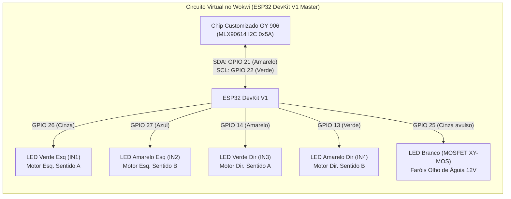

# 02. Guia Passo a Passo de Simulação (Wokwi)

A simulação no Wokwi reproduz exatamente os pinos da **ESP32 DevKit V1 (Master)**: controle PWM de 4 canais da Ponte H L298N (`GPIO 26, 27, 14, 13`), leitura I2C do sensor térmico MLX90614 (`GPIO 21, 22`), acionamento PWM do Módulo MOSFET `XY-MOS V921` (`GPIO 25`) e Watchdog Failsafe de `1000 ms`.

---

## 1. Diagrama do Circuito no Simulador (`diagram.json`)

---

## 2. Passo a Passo para Rodar a Simulação no VS Code

1. **Selecionar Ambiente:** Na barra inferior do VS Code, selecione **`env:wokwi`** e clique em **Build (`✓`)**.
2. **Iniciar Simulador:** Abra o arquivo [`diagram.json`](file:///home/tacio/dev/academic/robo-inspetor/diagram.json) e clique no botão verde **Play**.
3. **Comandos de Teste no Terminal Serial do Wokwi:**
   - Digite **`t`** -> **Auto-Teste de Bancada** (testa Farol `GPIO 25` e dá um pulso de `400 ms` em cada pino dos motores: `26`, `27`, `14` e `13`).
   - Digite **`w`** -> **Frente** (acendem os LEDs verdes `GPIO 26` e `GPIO 14`).
   - Digite **`s`** -> **Ré** (acendem os LEDs amarelos `GPIO 27` e `GPIO 13`).
   - Digite **`a`** -> **Giro à Esquerda** (`GPIO 27` + `GPIO 14`).
   - Digite **`d`** -> **Giro à Direita** (`GPIO 26` + `GPIO 13`).
   - Digite **`Espaço`** -> **Parada Imediata** (todos os 4 LEDs apagam).
   - Digite **`l`** -> **Liga / Desliga os Faróis** no Módulo MOSFET `XY-MOS` (`GPIO 25`).
4. **Testar Proteções:**
   - **Failsafe (`1000 ms`):** Pare de enviar comandos por 1 segundo e veja os LEDs dos motores apagarem sozinhos (`"watchdog": true`).
   - **Temperatura (`gy906`):** Clique no sensor `gy906` e aumente o slider `Temp Objeto` para **`>= 50 °C`** (Alerta Preventivo) e **`>= 70 °C`** (Corte Crítico dos motores).

---

## 3. Componentes no Simulador vs. Robô Físico

| Componente do Robô | Está no Wokwi? | Por quê? |
| :--- | :---: | :--- |
| **ESP32 DevKit V1 (Master)** | **SIM** | Executa o firmware C++ real compilado em `src/`. |
| **Sensor MLX90614 (GY-906)** | **SIM** | Emulado via WebAssembly (`simulacao_sensor_termico/gy906/gy906.wasm`) em `GPIO 21` e `22`. |
| **Ponte H L298N (`IN1..IN4`)** | **SIM (4 LEDs)** | Representa os pulsos PWM enviados pelos pinos `GPIO 26, 27, 14 e 13`. |
| **Módulo MOSFET `XY-MOS V921` (`TRIG/PWM`)** | **SIM (LED Branco)** | Representa o sinal PWM enviado pela `GPIO 25` para chavear `OUT+`/`OUT-` dos faróis. |
| **ESP32-CAM (Slave — Vídeo)** | **NÃO** | No robô real, fica isolada apenas transmitindo vídeo MJPEG na porta `81`. |
| **Bateria 3S2P, Chave KCD1, Fusível 15A, Step-Up 400W (24V), Step-Down LM2596 (5V), Cooler 80mm (12V) e Voltímetro 3 Fios** | **NÃO** | São componentes elétricos de alimentação/medição direta que não dependem de código. |
