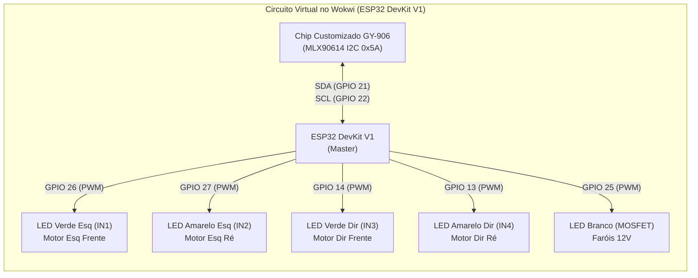

# 02. Guia Passo a Passo de Simulação (Wokwi)

A simulação no Wokwi testa toda a lógica da **ESP32 DevKit V1 (Master)**: controle PWM de 4 pinos da Ponte H L298N, leitura I2C do sensor térmico MLX90614, acionamento PWM do Módulo MOSFET dos faróis e trava de segurança (Failsafe de 1 segundo).

---

## 1. Diagrama do Circuito no Simulador (`diagram.json`)

---

## 2. Passo a Passo para Rodar a Simulação no VS Code

1. **Abrir o Projeto:** Abra a pasta `/home/tacio/dev/academic/robo-inspetor` no VS Code com as extensões **PlatformIO IDE** e **Wokwi Simulator** instaladas.
2. **Compilar:** Selecione o ambiente **`env:wokwi`** na barra azul inferior e clique em **Build (`✓`)** (ou pressione `Ctrl+Alt+B`).
3. **Iniciar o Simulador:** Abra o arquivo [`diagram.json`](file:///home/tacio/dev/academic/robo-inspetor/diagram.json) e clique no botão verde **Play**.
4. **Testar os Motores e Faróis pelo Teclado (No Terminal Serial do Wokwi):**
   - Digite **`w`** -> Anda para **Frente** (acendem os LEDs verdes `GPIO 26` e `GPIO 14`).
   - Digite **`s`** -> Anda de **Ré** (acendem os LEDs amarelos `GPIO 27` e `GPIO 13`).
   - Digite **`a`** -> **Gira para a Esquerda** (`GPIO 27` + `GPIO 14`).
   - Digite **`d`** -> **Gira para a Direita** (`GPIO 26` + `GPIO 13`).
   - Digite **`Espaço`** -> **Parada Imediata** (todos os 4 LEDs apagam).
   - Digite **`l`** -> **Liga / Desliga o Farol** (acende ou apaga o LED branco na `GPIO 25`).
5. **Testar os Gatilhos de Temperatura e o Failsafe:**
   - **Failsafe de 1 Segundo (`1000 ms`):** Pare de digitar qualquer tecla por 1 segundo. Os LEDs dos motores apagam sozinhos e o terminal mostra `"watchdog": true`.
   - **Alerta Térmico:** Clique em cima do sensor **`gy906`** no simulador e suba o slider `Object Temp` para **`>= 50 °C`** (alerta preventivo) e **`>= 70 °C`** (corte imediato dos motores).

---

## 3. O Que Está no Simulador vs. O Que Só Existe no Robô Físico

| Componente do Robô | Está no Wokwi? | Por quê? |
| :--- | :---: | :--- |
| **ESP32 DevKit V1 (Master)** | **SIM** | Executa o firmware C++ real da placa Master. |
| **Sensor MLX90614 (GY-906)** | **SIM** | Emulado via WebAssembly (`chips/gy906/gy906.wasm`) nos pinos `GPIO 21` e `GPIO 22`. |
| **Ponte H L298N (`IN1..IN4`)** | **SIM (4 LEDs)** | Os 4 LEDs mostram exatamente o pulso PWM dos pinos `GPIO 26, 27, 14 e 13`. |
| **Módulo MOSFET (Faróis 12V)** | **SIM (LED Branco)** | O LED branco mostra o acionamento PWM na `GPIO 25`. |
| **ESP32-CAM (Slave — Vídeo)** | **NÃO** | No robô físico ela fica isolada apenas transmitindo vídeo na porta `81` (`192.168.1.101`). |
| **Bateria 3S2P, Chave KCD1, Fusível 15A, Step-Up 24V, LM2596 5V, Cooler 12V e Voltímetro 3 Fios** | **NÃO** | São componentes elétricos passivos/analógicos de alimentação que não dependem de código. |
