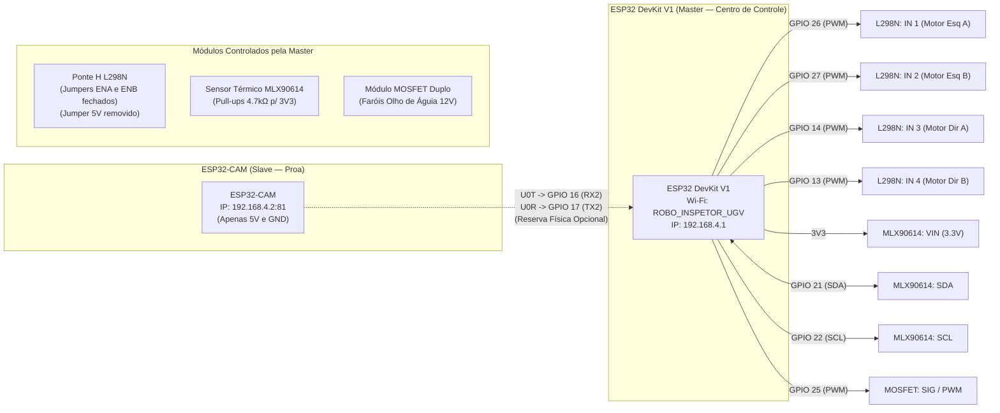

# 03. Roteiro de Bancada: Ligações Lógicas e Montagem Passo a Passo

Guia direto para fiação lógica da **ESP32 DevKit V1 (Master)** e isolamento da **ESP32-CAM (Slave)** na bancada.

---

## 1. Diagrama Lógico de Pinos e Sinais



---

## 2. Passo a Passo das Alterações Físicas no Chassi

### Passo 1 — Isolar a ESP32-CAM na Proa (Limpeza de Fios)
1. Solte da **ESP32-CAM** os 4 fios que iam para a Ponte H (`GPIO 12, 13, 14 e 15`).
2. Deixe na **ESP32-CAM** apenas os fios de alimentação **`5V`** e **`GND`** vindos da protoboard.
3. *(Opcional)* Os 2 fios seriais (`U0T` e `U0R` ligados em `GPIO 16` e `GPIO 17` da DevKit) podem permanecer passados no chassi como reserva física.

### Passo 2 — Ligar a Ponte H L298N na ESP32 DevKit V1
1. Mantenha os jumpers **`ENA`** e **`ENB`** **fechados** na placa L298N.
2. Confirme que o **jumper regulador de 5V** da placa L298N está **removido**.
3. Conecte os 4 fios de comando da L298N na **ESP32 DevKit V1**:
   - **`IN 1`** da L298N -> **`GPIO 26`** da ESP32 DevKit V1.
   - **`IN 2`** da L298N -> **`GPIO 27`** da ESP32 DevKit V1.
   - **`IN 3`** da L298N -> **`GPIO 14`** da ESP32 DevKit V1.
   - **`IN 4`** da L298N -> **`GPIO 13`** da ESP32 DevKit V1.

### Passo 3 — Ligar o Sensor Térmico (MLX90614) e os Faróis (Módulo MOSFET)
1. **Sensor Térmico MLX90614:**
   - Pino **`VIN`** -> Pino **`3V3`** da ESP32 DevKit V1.
   - Pino **`GND`** -> Barramento **`-` (GND)** da protoboard.
   - Pino **`SDA`** -> **`GPIO 21`** da ESP32 DevKit V1 *(com resistor pull-up de `4,7 kΩ` ligado ao `3V3`)*.
   - Pino **`SCL`** -> **`GPIO 22`** da ESP32 DevKit V1 *(com resistor pull-up de `4,7 kΩ` ligado ao `3V3`)*.
2. **Módulo MOSFET Duplo (Faróis 12V):**
   - Fios negativos dos dois Faróis 12V -> Borne **`OUT-`** do Módulo MOSFET.
   - Pino **`SIG / PWM`** do Módulo MOSFET -> **`GPIO 25`** da ESP32 DevKit V1.
   - Pino **`GND` lógico** do Módulo MOSFET -> Barramento **`-` (GND)** da protoboard.

---

## 3. Tabela Definitiva de Pinagem (ESP32 DevKit V1 — Master)

| Pino ESP32 DevKit V1 | Conectado Onde? | Função no Robô |
| :--- | :--- | :--- |
| **`VIN` (ou `5V`)** | Barramento **`+`** da Protoboard (5V) | Alimentação 5V vinda do Step-Down LM2596 |
| **`GND`** | Barramento **`-`** da Protoboard (GND) | Referência de terra comum (0V) |
| **`3V3`** | Pino **`VIN`** do Sensor MLX90614 | Alimentação 3,3V dedicada ao sensor térmico |
| **`GPIO 26`** | Pino **`IN 1`** da Ponte H L298N | Motor Esquerdo — Sentido A / PWM |
| **`GPIO 27`** | Pino **`IN 2`** da Ponte H L298N | Motor Esquerdo — Sentido B / PWM |
| **`GPIO 14`** | Pino **`IN 3`** da Ponte H L298N | Motor Direito — Sentido A / PWM |
| **`GPIO 13`** | Pino **`IN 4`** da Ponte H L298N | Motor Direito — Sentido B / PWM |
| **`GPIO 21`** | Pino **`SDA`** do Sensor MLX90614 | Dados I2C da temperatura |
| **`GPIO 22`** | Pino **`SCL`** do Sensor MLX90614 | Clock I2C da temperatura |
| **`GPIO 25`** | Pino **`SIG / PWM`** do Módulo MOSFET | Controle dos Faróis Olho de Águia 12V |
| **`GPIO 16` (`RX2`)** | Pino **`U0T`** da ESP32-CAM *(Opcional)* | Reserva física no chassi |
| **`GPIO 17` (`TX2`)** | Pino **`U0R`** da ESP32-CAM *(Opcional)* | Reserva física no chassi |

---

## 4. Passo a Passo para Gravar as Placas

Você pode gravar as placas usando a **Arduino IDE** (pelos 2 sketches prontos) ou o **PlatformIO**:

### Opção 1 — Pela Arduino IDE (Direto pelos Sketches `.ino`)
1. **Gravar a ESP32 DevKit V1 (Master):**
   - Abra [`arduino_sketches/esp32_devkit_master/esp32_devkit_master.ino`](file:///home/tacio/dev/academic/robo-inspetor/arduino_sketches/esp32_devkit_master/esp32_devkit_master.ino).
   - *(Não precisa alterar Wi-Fi: ela já cria a rede própria `ROBO_INSPETOR_UGV` com senha `12345678` e IP `192.168.4.1`).*
   - Selecione a placa **DOIT ESP32 DEVKIT V1** e clique em **Upload**.
2. **Gravar a ESP32-CAM (Slave):**
   - Abra [`arduino_sketches/esp32_cam_stream/esp32_cam_stream.ino`](file:///home/tacio/dev/academic/robo-inspetor/arduino_sketches/esp32_cam_stream/esp32_cam_stream.ino).
   - *(Não precisa alterar Wi-Fi: ela já conecta automaticamente na rede `ROBO_INSPETOR_UGV` com IP `192.168.4.2`).*
   - Selecione a placa **AI Thinker ESP32-CAM** e clique em **Upload**.

### Opção 2 — Pelo PlatformIO (VS Code)
1. **Gravar a ESP32 DevKit V1 (Master):**
   ```bash
   pio run -e esp32_hardware --target upload
   ```
2. **Gravar a ESP32-CAM (Slave):**
   ```bash
   pio run -e esp32cam_hardware --target upload
   ```
