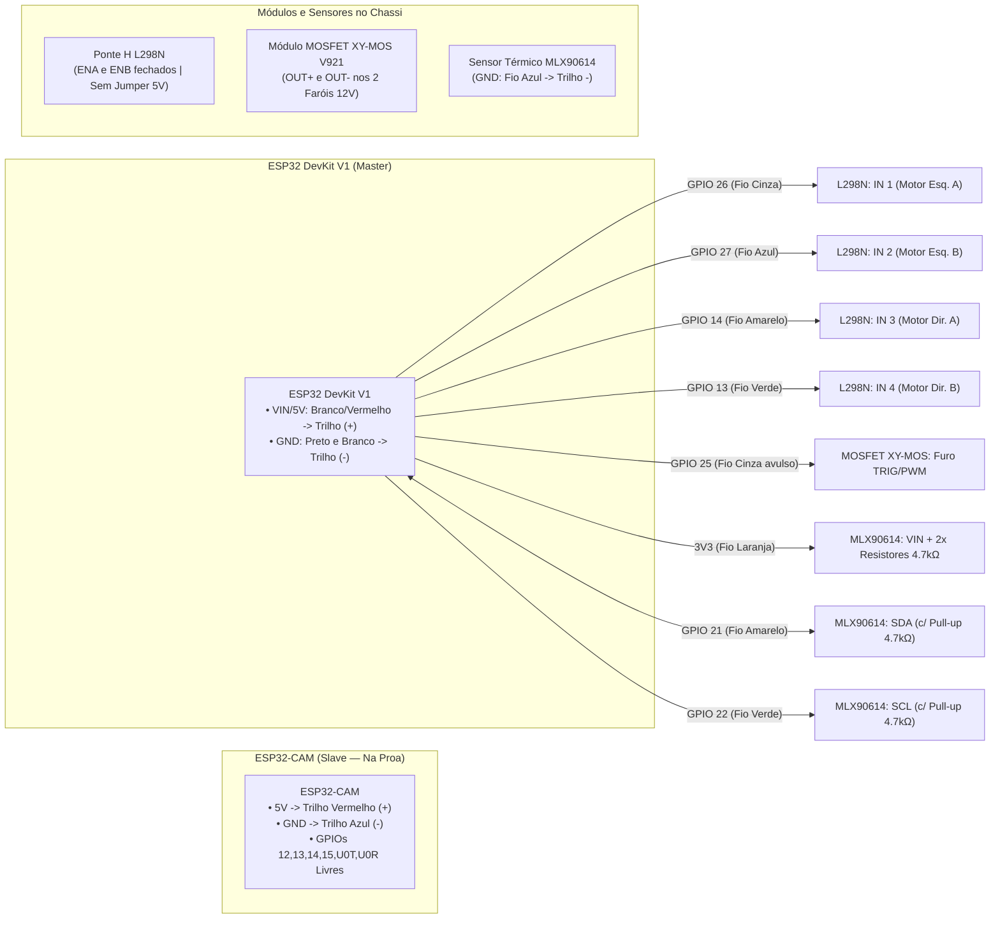

# 03. Roteiro de Bancada: Barramentos da Protoboard, Pinagem e Gravação

Guia direto com a fiação oficial dos trilhos da protoboard, cores exatas dos jumpers na **ESP32 DevKit V1 (Master)**, isolamento da **ESP32-CAM (Slave)** e procedimento de gravação.

---

## 1. Diagrama Lógico de Pinos e Cores dos Fios

---

## 2. Ligações nos Trilhos da Protoboard

### A. Trilho Vermelho (`+` 5V)
* **Entrada:** Fio vindo do `OUT+` (5V) do Step-Down LM2596 *(o segundo fio do `OUT+` do Step-Down vai direto ao borne `5V` da Ponte H L298N)*.
* **Saídas no Trilho Vermelho (`+`):**
  1. **Capacitor Eletrolítico** (perna positiva).
  2. **Jumper `VIN/5V` da ESP32 DevKit V1** (fio Branco/Vermelho — **retirar este fio ao gravar via cabo USB**).
  3. **Fio `5V` da ESP32-CAM**.

### B. Trilho Azul (`-` GND Geral)
* **Entrada:** Fio vindo do `OUT-` do Step-Down LM2596 (unificando o terra da bateria com a protoboard).
* **Saídas no Trilho Azul (`-`):**
  1. **Capacitor Eletrolítico** (lado da faixa negativa).
  2. **`GND` da ESP32 DevKit V1** (fio Preto e Branco).
  3. **`GND` da ESP32-CAM**.
  4. **`GND` do Sensor MLX90614** (fio Azul).
  5. **Fio de `GND` da Ponte H L298N** (junto ao `OUT-` do Step-Up).
  6. **Furo `GND` lógico do Módulo MOSFET (`XY-MOS V921`)**.
  7. **Fio Preto do Cooler / Fan 80mm (12V)**.
  8. **Fio Preto do Voltímetro Digital (3 Fios)**.

---

## 3. Tabela Oficial de Pinos e Cores da ESP32 DevKit V1 (Master)

| Pino na ESP32 DevKit V1 | Constante no Código (`config.h`) | Cor do Jumper Físico | Onde está Conectado (Destino) | Função no Sistema |
| --- | --- | --- | --- | --- |
| **`GPIO 26`** | `PIN_MOTOR_LEFT_IN1` | **Cinza** | Pino **`IN 1`** da Ponte H L298N | PWM Motor Esquerdo Sentido A (Canal LEDC 0) |
| **`GPIO 27`** | `PIN_MOTOR_LEFT_IN2` | **Azul** | Pino **`IN 2`** da Ponte H L298N | PWM Motor Esquerdo Sentido B (Canal LEDC 1) |
| **`GPIO 14`** | `PIN_MOTOR_RIGHT_IN3` | **Amarelo** | Pino **`IN 3`** da Ponte H L298N | PWM Motor Direito Sentido A (Canal LEDC 2) |
| **`GPIO 13`** | `PIN_MOTOR_RIGHT_IN4` | **Verde** | Pino **`IN 4`** da Ponte H L298N | PWM Motor Direito Sentido B (Canal LEDC 3) |
| **`GPIO 25`** | `PIN_HEADLIGHT_MOSFET` | **Cinza** (avulso) | Furo **`TRIG/PWM`** do Módulo MOSFET (`XY-MOS`) | Controle PWM/Digital dos Faróis Olho de Águia (Canal LEDC 4) |
| **`GPIO 21` (`SDA`)** | `PIN_I2C_SDA` | **Amarelo** | Pino **`SDA`** do Sensor MLX90614 | Dados I2C + Resistor pull-up de `4.7kΩ` ligado ao `3V3` |
| **`GPIO 22` (`SCL`)** | `PIN_I2C_SCL` | **Verde** | Pino **`SCL`** do Sensor MLX90614 | Clock I2C + Resistor pull-up de `4.7kΩ` ligado ao `3V3` |
| **`3V3`** | — | **Laranja** | Pino **`VIN`** do Sensor MLX90614 | Alimenta o sensor em 3.3V e os 2 resistores de `4.7kΩ` |
| **`VIN` (ou `5V`)** | — | **Branco / Vermelho** | **Trilho Vermelho (`+` 5V)** da Protoboard | Entrada de 5V da placa (retirar ao gravar via cabo USB) |
| **`GND`** | — | **Preto e Branco** | **Trilho Azul (`-` GND)** da Protoboard | Terra comum de referência (0V) |

---

## 4. Ligações da ESP32-CAM (Slave — Na Proa)

* **Pino `5V`:** Conectado ao **Trilho Vermelho (`+` 5V)** da Protoboard.
* **Pino `GND`:** Conectado ao **Trilho Azul (`-` GND)** da Protoboard.
* **Pinos `GPIO 12, 13, 14, 15, U0T, U0R`:** Totalmente livres/desconectados.

---

## 5. Passo a Passo para Gravar as Placas no VS Code (PlatformIO)

### Placa 1 — Gravar a ESP32 DevKit V1 (Master)
1. **Desligue a chave geral da bateria** e **retire o jumper `VIN/5V` (Branco/Vermelho)** da ESP32 DevKit V1 antes de plugar o cabo USB.
2. Plugue o cabo USB na **ESP32 DevKit V1**.
3. Na barra inferior do VS Code, selecione **`env:esp32_hardware`** e clique na setinha **`→` (Upload)**.
4. Ao terminar (`[SUCCESS]`), tire o cabo USB e reconecte o jumper `VIN/5V` (Branco/Vermelho) no Trilho Vermelho (`+`) da protoboard.

### Placa 2 — Gravar a ESP32-CAM SEM Adaptador (Usando a DevKit V1 como Ponte USB)
> [!IMPORTANT]
> **REGRA DE OURO DO GND COMUM (0V):**
> Use o **Trilho Azul (`-`) da Protoboard** para reunir todos os terras durante a gravação:
> - `GND` da DevKit -> Trilho Azul (`-`)
> - `GND` da CAM -> Trilho Azul (`-`)
> - Jumper do pino `EN` (DevKit) -> Trilho Azul (`-`)
> - Jumper do pino `IO0` (CAM) -> Trilho Azul (`-`)

1. Com a **bateria desligada**, espete um jumper do pino **`EN`** da DevKit V1 no **Trilho Azul (`-`)** e outro jumper do pino **`IO0`** da ESP32-CAM no **Trilho Azul (`-`)**.
2. Ligue temporariamente 2 fios de comunicação entre as placas:
   - **`TX0` (`TX`)** da DevKit V1 -> **`U0T`** da ESP32-CAM.
   - **`RX0` (`RX`)** da DevKit V1 -> **`U0R`** da ESP32-CAM.
3. Mantenha o `5V` e `GND` das duas placas no trilho da protoboard (com o Step-Down desligado) para que o USB da DevKit alimente a CAM.
4. No VS Code, selecione **`env:esp32cam_hardware`** e clique em **`→` (Upload)** *(se pedir `Connecting...`, aperte 1 vez o botão `RST` atrás da ESP32-CAM)*.
5. Ao terminar (`[SUCCESS]`), tire o cabo USB, **remova os jumpers `IO0`, `EN`, `TX0` e `RX0`** (deixando a CAM apenas com `5V` e `GND`) e grave novamente o `env:esp32_hardware` na DevKit V1.
