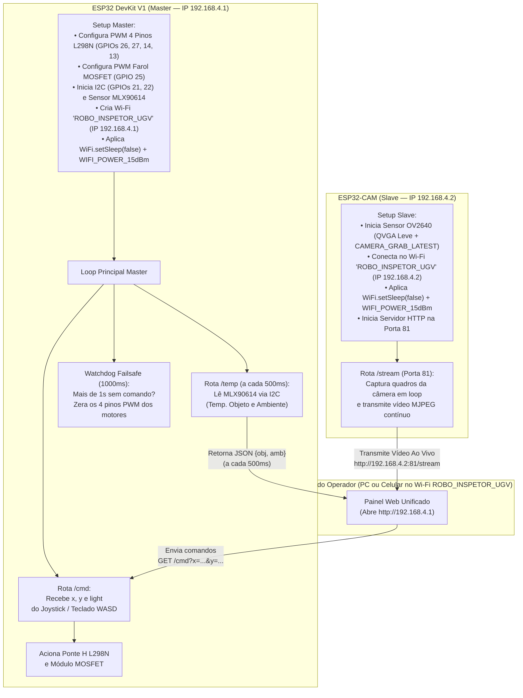

# 04. Arquitetura de Software e Passo a Passo de Operação

Fluxo direto de funcionamento conjunto entre a **ESP32 DevKit V1 (Master — `192.168.4.1`)**, a **ESP32-CAM (Slave — `192.168.4.2:81`)** e o **Navegador do Operador** usando a rede Wi-Fi própria do robô (`ROBO_INSPETOR_UGV`), sem depender de internet ou roteador externo.

---

## 1. Diagrama da Arquitetura de Software (Master + Slave)



---

## 2. Passo a Passo de Operação do Robô (Do Ligar ao Desligar)

### Passo 1 — Ligar a Chave Geral (Energização)
1. Acione a **Chave Gangorra KCD1**.
2. O **Voltímetro Digital de 3 Fios** mostra a tensão da bateria 3S2P no chassi e o **Cooler de 80mm (12V)** começa a girar imediatamente.
3. O **Step-Up 400W** entrega **24V** para a Ponte H L298N e o **Step-Down LM2596** entrega **5V** na protoboard, ligando a **ESP32 DevKit V1** e a **ESP32-CAM**.

### Passo 2 — Rede Wi-Fi Própria do Robô (Zero Internet Externa)
1. A **ESP32 DevKit V1 (Master)** cria automaticamente a rede Wi-Fi **`ROBO_INSPETOR_UGV`** (senha: **`12345678`**) com o IP fixo **`192.168.4.1`**.
2. A **ESP32-CAM (Slave)** se conecta automaticamente nessa rede `ROBO_INSPETOR_UGV` com o IP fixo **`192.168.4.2`** e inicia o streaming na porta **`81`**.
3. Ambas rodam com 3 travas anti-lag e anti-ruído:
   - `WiFi.setSleep(false)`: Desliga a economia de energia do rádio Wi-Fi, reduzindo a latência de resposta de `~400 ms` para `~15 ms`.
   - `WiFi.setTxPower(WIFI_POWER_15dBm)`: Evita saturação de sinal por estarem próximas dentro do chassi.
   - `FRAMESIZE_QVGA` + `CAMERA_GRAB_LATEST`: Vídeo leve (`~120 kbps`) que descarta quadros atrasados e não trava os comandos do joystick.

### Passo 3 — Conectar o Celular/Notebook e Abrir o Painel
1. No seu celular ou notebook, conecte no Wi-Fi **`ROBO_INSPETOR_UGV`** (senha **`12345678`**).
2. Abra o navegador e digite:
   ```text
   http://192.168.4.1
   ```
3. A página carrega os controles da **ESP32 DevKit V1** e exibe o vídeo ao vivo da **ESP32-CAM** (`http://192.168.4.2:81/stream`).

### Passo 4 — Pilotar o Robô e Acionar os Faróis
1. **Pelo Joystick Virtual (Tela/Touch/Mouse):** Arraste o círculo central na direção desejada. O painel calcula a velocidade de cada roda (`vL` e `vR`) e envia para a Master a cada `150 ms`.
2. **Pelo Teclado (`W, A, S, D`):** Pressione `W` (frente), `S` (ré), `A` (esquerda), `D` (direita) ou `Espaço` (parar).
3. **Faróis 12V:** Clique no botão **Alternar Farol** (ou aperte a tecla `L`) para chavear o Módulo MOSFET na `GPIO 25`.

### Passo 5 — Acompanhar a Temperatura e Travas de Segurança
1. **Leitura Térmica (`500 ms`):** A cada meio segundo, a tela atualiza a temperatura do **Objeto (`TO`)** e **Ambiente (`TA`)** lidas do sensor MLX90614 (`GPIO 21/22`).
   - **`>= 50 °C`:** Alerta amarelo na tela.
   - **`>= 70 °C`:** Parada crítica automática (desliga os motores na hora).
2. **Failsafe de 1 Segundo (`1000 ms`):** Se você soltar o joystick/teclado ou se o sinal Wi-Fi cair por mais de **1 segundo**, a ESP32 DevKit V1 corta o PWM dos 4 pinos da Ponte H automaticamente, travando o robô com segurança.
