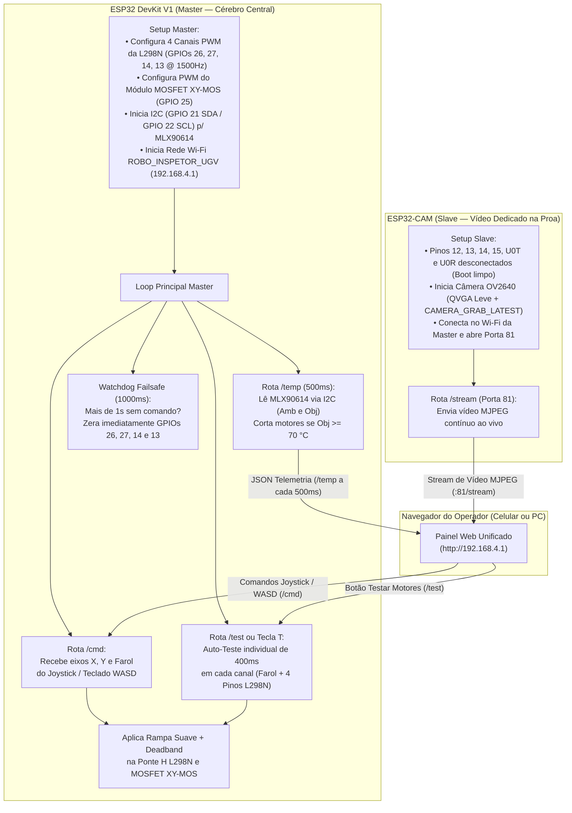

# 04. Arquitetura de Software e Passo a Passo de Operação

Fluxo direto de operação entre a **ESP32 DevKit V1 (Master)**, a **ESP32-CAM (Slave)** e o **Painel Web do Operador**.

---

## 1. Diagrama da Arquitetura de Software (Master + Slave)



---

## 2. Passo a Passo de Operação (Do Ligar ao Primeiro Teste)

### Passo 1 — Ligar a Chave Gangorra KCD1 (Energização)
1. Ao ligar a **Chave KCD1**, a corrente passa pelo **Fusível de 15A** e alimenta o **Chicote Principal 12V**.
2. O **Cooler 80mm (12V)** gira continuamente e o **Voltímetro Digital de 3 Fios** mostra a tensão da bateria 3S2P no chassi.
3. O **Step-Up 400W** entrega **24V** ao borne `12V/VCC` da Ponte H L298N.
4. O **Step-Down LM2596** entrega **5V** por 2 fios: um vai direto ao borne `5V` da L298N e o outro alimenta o **Trilho Vermelho (`+`) da Protoboard** (ligando a ESP32 DevKit V1 e a ESP32-CAM).

### Passo 2 — Conectar no Wi-Fi do Robô e Abrir o Painel
1. No seu celular ou notebook, conecte na rede Wi-Fi criada pela ESP32 DevKit V1:
   - **Rede (SSID):** `ROBO_INSPETOR_UGV`
   - **Senha:** `12345678`
2. Abra o navegador e acesse:
   ```text
   http://192.168.4.1
   ```

### Passo 3 — Executar o Primeiro Teste de Motores e Faróis (`Botão Testar Motores` ou `Tecla T`)
1. Com as rodas/polias livres do chão, clique no botão **`Testar Motores (T)`** no Painel Web (ou digite **`t`** no Monitor Serial do VS Code).
2. A ESP32 DevKit V1 testa automaticamente cada saída na ordem abaixo:
   - **Pisca os 2 Faróis Olho de Águia 12V** (`OUT+` / `OUT-` do Módulo MOSFET `XY-MOS` via fio cinza na `GPIO 25`).
   - **Gira o Motor Esquerdo para FRENTE** por `400 ms` (`IN 1` — fio cinza na `GPIO 26`) e para.
   - **Gira o Motor Esquerdo para RÉ** por `400 ms` (`IN 2` — fio azul na `GPIO 27`) e para.
   - **Gira o Motor Direito para FRENTE** por `400 ms` (`IN 3` — fio amarelo na `GPIO 14`) e para.
   - **Gira o Motor Direito para RÉ** por `400 ms` (`IN 4` — fio verde na `GPIO 13`) e para.

### Passo 4 — Pilotagem Normal e Travas Automáticas
1. **Movimentação:** Use o **Joystick Virtual** na tela ou as teclas **`W, A, S, D`** (e **`Espaço`** para frear).
2. **Faróis 12V:** Clique no botão **`Farol 12V (L)`** ou mova a barra deslizante para regular o brilho em PWM no módulo `XY-MOS`.
3. **Proteção Térmica (`GPIO 21/22`):**
   - **`>= 50 °C`:** Exibe alerta amarelo na tela.
   - **`>= 70 °C`:** Corta os motores imediatamente.
4. **Watchdog Failsafe (`1000 ms`):** Se ficar mais de **1 segundo** sem receber comando, a ESP32 DevKit V1 zera os 4 pinos da Ponte H automaticamente.
