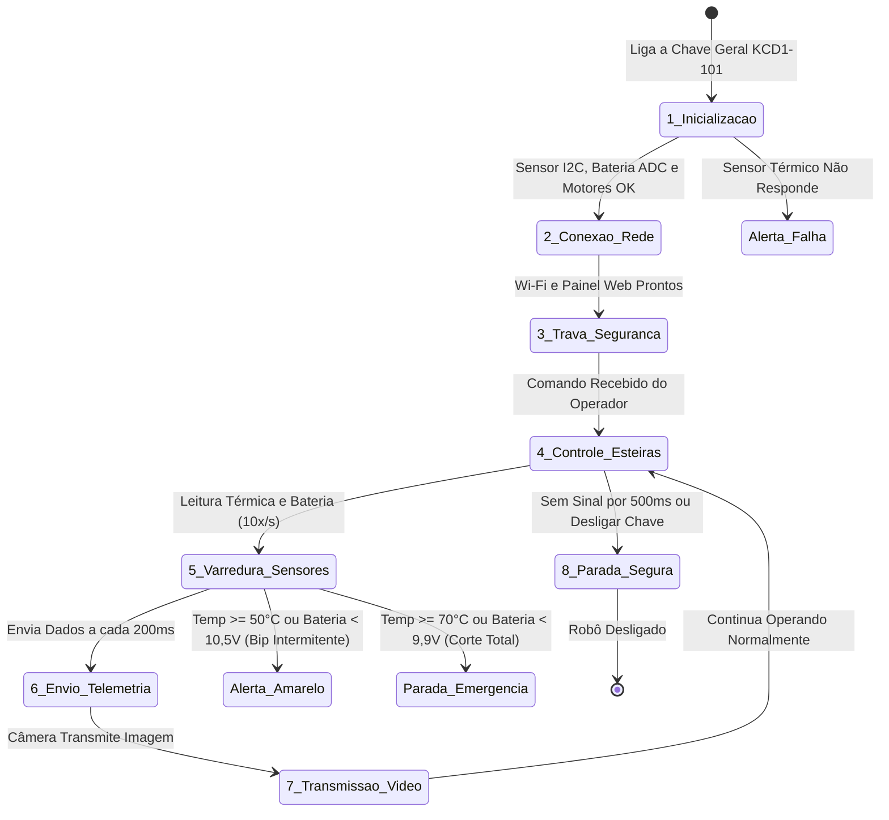

# 04. Roteiro de Operação: Passo a Passo do Robô (Do Ligar ao Desligar)

Este documento explica de forma simples, clara e didática como o cérebro do robô (ESP32) funciona por dentro, desde o momento em que a chave geral é ligada até o desligamento seguro.

---

## Glossário Rápido de Termos Técnicos
Para facilitar a leitura de quem está conhecendo o projeto:
* **Boot:** O processo de inicialização do robô ao ligar a energia.
* **Firmware:** O programa em C++ gravado dentro da memória da ESP32.
* **Dual-Core:** A ESP32 possui dois processadores ("cérebros") independentes dentro do mesmo chip (Core 0 e Core 1), trabalhando juntos ao mesmo tempo.
* **I2C:** Tipo de cabo de comunicação simples (apenas 2 fios) que liga os sensores ao processador.
* **ADC (Conversor Analógico-Digital):** Porta da ESP32 (`GPIO 34`) que mede a voltagem da bateria através de um divisor de tensão ($10\text{ k}\Omega$ e $3,3\text{ k}\Omega$) e transforma em porcentagem de carga (0% a 100%).
* **PWM:** Sinal eletrônico pulsado usado para controlar a velocidade dos motores e o brilho das luzes.
* **Failsafe / Watchdog (Cão de Guarda):** Trava de segurança automática que para o robô se perder a conexão de rede.
* **Slew Rate Limiter (Rampa de Aceleração):** Filtro que faz o robô acelerar suavemente, sem dar trancos que possam quebrar as engrenagens.
* **Deadband (Zona Morta):** Força mínima inicial para fazer a esteira sair do lugar e vencer o atrito da borracha.
* **Telemetria:** Envio contínuo das informações de temperatura, bateria, velocidade e status do robô para a tela do operador.
* **MJPEG Stream:** Transmissão de vídeo ao vivo pela rede (como uma webcam).
* **Shutdown:** O processo de parada e desligamento seguro do robô.

---

## 1. Divisão do Trabalho nos Dois Processadores (Dual-Core)

Para que a transmissão do vídeo e a rede Wi-Fi não travem as esteiras nem causem atrasos nos motores, dividimos as tarefas entre os dois processadores da ESP32:

```
                  +-----------------------------------------+
                  |         ESP32 COM DOIS NÚCLEOS          |
                  +--------------------+--------------------+
                                       |
                   +-------------------+-------------------+
                   |                                       |
                   v                                       v
         +--------------------+                  +--------------------+
         |      NÚCLEO 0      |                  |      NÚCLEO 1      |
         | (Rede e Imagem)    |                  | (Motores e Sensor) |
         +--------------------+                  +--------------------+
         | • Cria o Wi-Fi     |                  | • Controle das     |
         | • Página Web       |                  |   esteiras (PWM)   |
         | • Vídeo da câmera  |                  | • Trava de 500ms   |
         | • Telemetria JSON  |                  | • Leitura térmica  |
         |   a cada 200ms     |                  |   e bateria (ADC)  |
         +--------------------+                  +--------------------+
```

---

## 2. As 8 Etapas do Ciclo de Operação do Robô



---

### Explicação Detalhada de Cada Etapa:

### Etapa 1: Inicialização e Autoteste (Boot & Self-Test)
* **O que acontece:** Assim que você liga a chave geral, o cooler de 5V (`DF0922505SEL`) entra em operação na saída do regulador LM2596 e o cérebro do robô faz um teste rápido de saúde.
* **O que ele verifica:** Testa se o sensor térmico GY-906 está respondendo no barramento I2C, mede a voltagem inicial da bateria 3S2P na porta `GPIO 34` e configura os motores na frequência ideal de 1500 Hz (frequência sem aquecimento para a placa L298N).

### Etapa 2: Conexão de Rede e Servidor de Controle
* **O que acontece:** A ESP32 cria sua própria rede Wi-Fi (`ROBO_INSPETOR_UGV`).
* **Como funciona:** Você conecta seu celular ou computador nessa rede e abre a página de controle no navegador para pilotar o robô e acompanhar a temperatura e a bateria na tela.

### Etapa 3: Trava Automática de Segurança (Watchdog / Failsafe de 500 ms)
* **O que acontece:** Um cronômetro interno monitora a conexão a cada instante.
* **Como protege o robô:** Se o sinal de Wi-Fi cair, o celular descarregar ou o robô perder contato por mais de **meio segundo (500 milissegundos)**, ele desliga os motores na mesma hora (`velocidade = 0`). Isso impede que o robô continue andando sozinho e bata.

### Etapa 4: Movimentação Suave das Esteiras (Tração com Rampa de Aceleração)
* **O que acontece:** O robô recebe a ordem de andar para frente, ré ou girar.
* **Aceleração sem trancos:** Em vez de dar uma arrancada violenta que derraparia as esteiras e forçaria a bateria, a velocidade sobe em degraus suaves a cada 20 milissegundos (*Slew Rate Limiter*). Além disso, ele aplica uma força mínima inicial (*Deadband*) para vencer o atrito da esteira de borracha.

### Etapa 5: Leitura Contínua da Temperatura e da Bateria (10x por segundo)
* **O que acontece:** A cada 100 ms, o sistema lê a temperatura infravermelha (sensor GY-906) e a tensão da bateria 3S2P (divisor $10\text{k}\Omega / 3,3\text{k}\Omega$ na `GPIO 34`).
* **As travas automáticas de proteção:**
  1. **Alerta Preventivo (Temperatura $\ge 50\text{ }^\circ\text{C}$ ou Bateria $< 10,5\text{ V}$):** O robô acende o LED vermelho e faz o Buzzer apitar de forma intermitente para avisar o operador.
  2. **Parada Crítica de Emergência (Temperatura $\ge 70\text{ }^\circ\text{C}$ ou Bateria $< 9,9\text{ V}$):** O robô desliga imediatamente a tração das esteiras e aciona o alarme contínuo, protegendo tanto a estrutura contra calor extremo quanto as células de lítio 3S contra descarga profunda irreversível.

### Etapa 6: Envio de Dados para a Tela (Telemetria a cada 200 ms)
* **O que acontece:** 5 vezes por segundo (a cada 200 ms), o robô monta um pacote organizado em formato JSON contendo temperatura ambiente/objeto, tensão e porcentagem da bateria, velocidade das esteiras e status do watchdog, enviando para o painel web e para a porta serial.

### Etapa 7: Transmissão de Vídeo da Câmera (Streaming)
* **O que acontece:** A imagem da câmera é enviada continuamente pela rede na porta 81.
* **No computador:** O operador assiste ao vivo o caminho por onde o robô está passando dentro do duto ou galeria.

### Etapa 8: Parada e Desligamento Seguro (Safe Shutdown)
* **O que acontece:** Quando o operador aperta o botão de parar ou antes de desligar a chave geral.
* **Como protege:** O sistema desliga os sinais de energia dos motores, solta os freios passivos e garante que nenhuma corrente elétrica fique presa no circuito antes de a energia ser cortada por completo.
